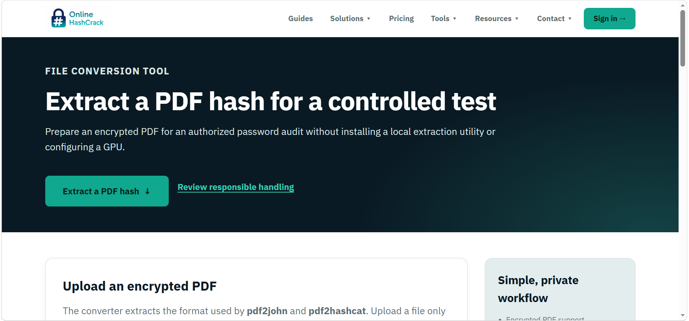
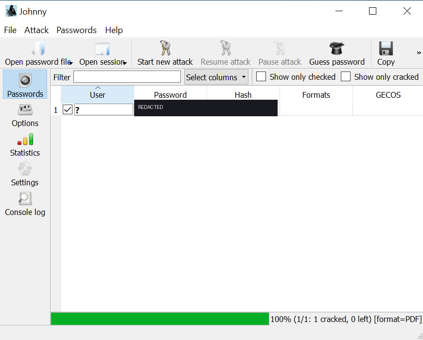
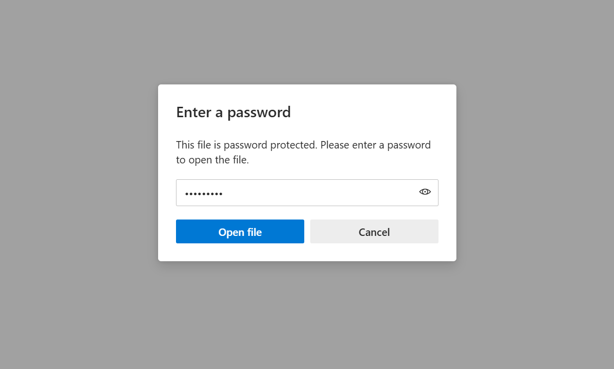

# PM1 — Password Cracking with John the Ripper (JTR) and Johnny GUI

## Objective

Understand a controlled password-auditing workflow for a password-protected PDF: obtain a crackable PDF hash, load it into Johnny (the graphical interface for John the Ripper), run the audit, and verify the result by opening the protected PDF.

## Tools and evidence observed

| Tool / component | What the supplied evidence shows |
|---|---|
| PDF hash extraction webpage (Online HashCrack branding visible) | A page offering extraction of a PDF hash for an authorized password audit |
| John the Ripper / Johnny | Johnny GUI displaying a PDF-format hash entry and a completed cracking status |
| Password-protected PDF viewer | A password prompt shown when opening the protected document |
| John the Ripper Windows distribution | A Windows JTR distribution was present in the uploaded archive; no CLI command transcript was supplied |

## Workflow documented by the screenshots

1. **Prepare the controlled PDF target.** The screenshot set includes a password-protected PDF prompt, establishing that the test document required a password to open.
2. **Extract a crackable PDF hash.** The supplied browser capture shows a PDF hash extraction page describing a workflow for an authorized password audit.
3. **Load and audit the hash in Johnny.** Johnny displays one entry in PDF format. Its status bar shows the run at 100%, with one item cracked and none left.
4. **Validate the result against the PDF.** A separate capture shows the password-entry prompt for the protected PDF. The password field is already masked in the evidence.
5. **Record module completion.** The supplied Networkwalks completion graphic confirms that the module was completed. Its flag value has been removed from this public copy.

> **CLI accuracy:** The project topic references John the Ripper. The supplied screenshots document Johnny GUI activity, not a terminal session. No CLI commands are included because none can be verified from the supplied evidence.

## Results

- Johnny displayed a completed run: **100% (1/1; 1 cracked, 0 left)**.
- The entry was identified by Johnny as **PDF** format.
- The screenshot evidence includes a subsequent password prompt for the protected PDF.
- The recovered password, hash value, and completion flag are intentionally not reproduced in this repository.

## Screenshots

All images below are sanitized copies of the supplied evidence.

### 1. PDF hash extraction page

### 2. Johnny GUI result

### 3. Password-protected PDF prompt

### 4. Module completion

## Key takeaways

- Password-protected documents can be assessed by working with an appropriate crackable hash representation rather than directly testing the document in a password prompt.
- Johnny provides a graphical workflow for interacting with John the Ripper.
- A completed cracking status is evidence of a match in the controlled test, not proof that a password is secure or insecure in every context.
- Sensitive values should be excluded from public evidence.

## Responsible-use boundary

This workflow is appropriate only for documents you own or have explicit permission to test. Do not use extracted hashes to access another person's files or disclose recovered credentials.
