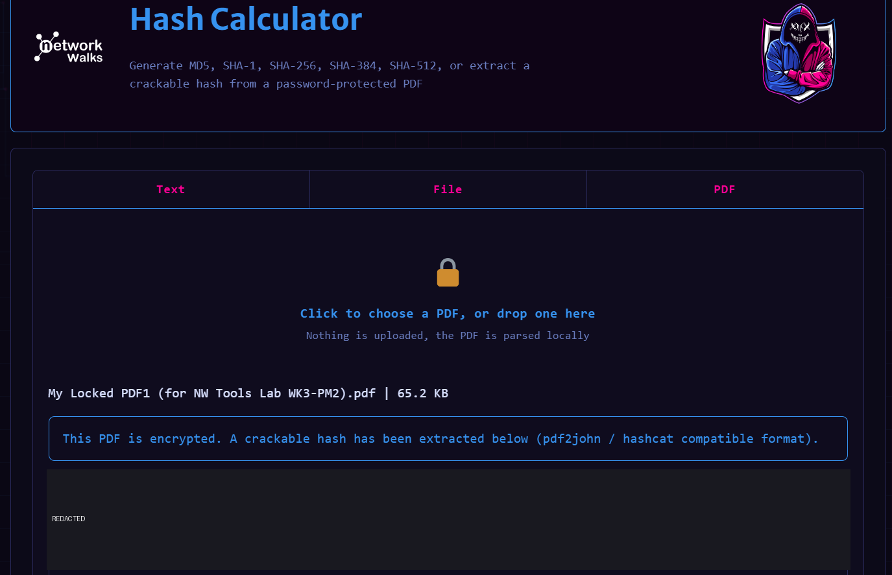
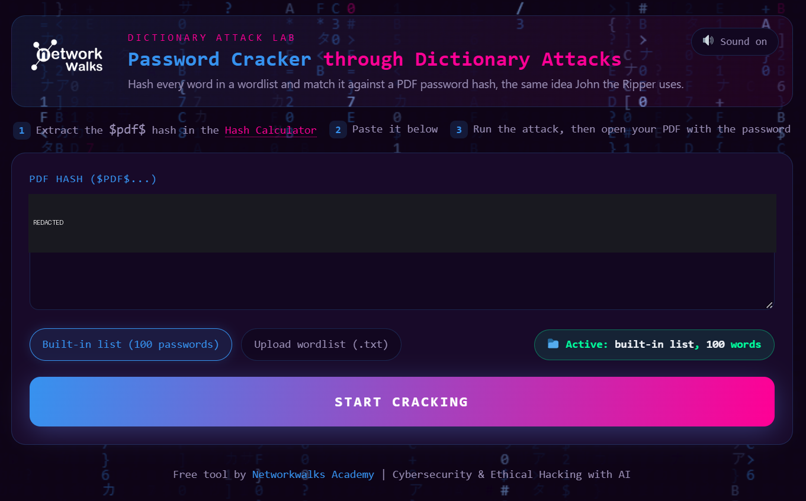
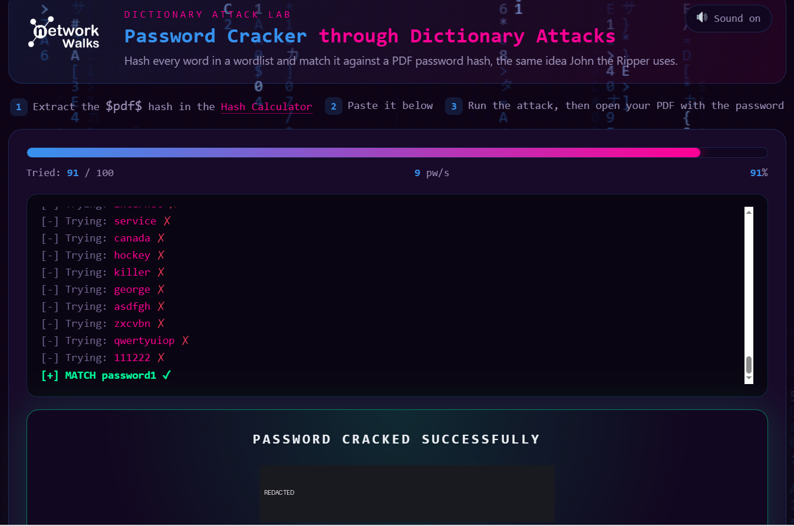

# PM2 — Networkwalks Hash Calculator and Password Cracker

## Objective

Use the Networkwalks lab tools to extract a crackable hash from a password-protected PDF and test candidate passwords with a dictionary-based password-cracking workflow.

## Tools and capabilities visible in the evidence

| Tool | Capability shown in the screenshot |
|---|---|
| Networkwalks Hash Calculator | Offers MD5, SHA-1, SHA-256, SHA-384, SHA-512 generation and extraction of a crackable hash from a password-protected PDF |
| Networkwalks Password Cracker | Accepts a PDF hash and runs a dictionary attack |
| Built-in wordlist | The Password Cracker screen shows a built-in list containing 100 passwords |
| PDF reader | The tool's on-screen instructions say to open the PDF with the password after the attack |

The Hash Calculator screenshot states that the PDF is parsed locally and that the extracted hash is in a `pdf2john` / Hashcat-compatible format. This is reported as visible interface text, not as an independently tested security or privacy guarantee.

## Workflow documented by the screenshots

1. **Select the PDF in the Hash Calculator.** The screenshot shows a password-protected PDF selected in the PDF tab.
2. **Extract the PDF hash.** The tool reports that the PDF is encrypted and that a crackable hash has been extracted. The raw hash is redacted in this repository.
3. **Transfer the hash to the Password Cracker.** The Password Cracker screen contains a PDF-hash input area. The raw value is hidden in the public screenshot.
4. **Choose a candidate list.** The interface shows the built-in list option and indicates a list size of 100 words. The screen also offers an option to upload a `.txt` wordlist.
5. **Run the dictionary attack.** The evidence shows progress at 91/100 (91%) and a rate of 9 passwords per second at the captured moment. A successful match is displayed in the same capture.
6. **Record completion.** A Networkwalks completion graphic confirms that the first flag was captured. The flag value has been redacted.

## Results

- The Hash Calculator displayed a successful PDF hash extraction.
- The Password Cracker showed a dictionary run using its built-in 100-word list.
- At the captured progress point, the interface displayed **91/100 tried**, **9 pw/s**, and **91%**.
- The interface subsequently displayed a successful password match.
- The recovered password, raw PDF hash, and completion flag are intentionally not included.

## Screenshots

All images below are sanitized copies of the supplied evidence.

### 1. Hash Calculator

### 2. Password Cracker input

### 3. Dictionary attack result

### 4. Module completion

## Key takeaways

- Hash extraction and password guessing are distinct stages in a PDF password-auditing workflow.
- A dictionary attack tests candidate strings from a wordlist; its success depends on whether a candidate matches the protected document's password.
- A built-in wordlist is convenient for a lab demonstration but is not exhaustive.
- Progress rate and completion percentage are observations from one screenshot, not general performance benchmarks.
- Avoid exposing the input hash or recovered password when publishing project evidence.

## Responsible-use boundary

Use the Networkwalks tools only with lab files you are authorized to assess. Do not upload private documents to third-party services without permission and a clear understanding of their data-handling practices.
